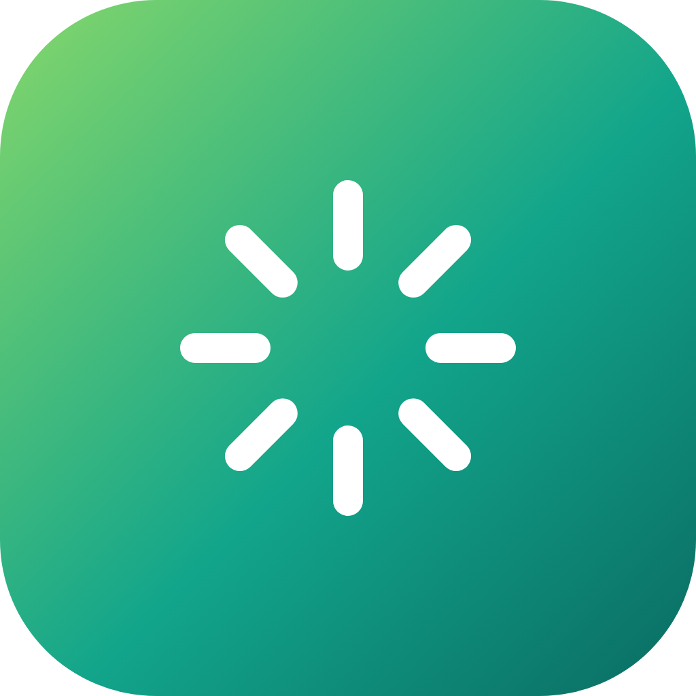
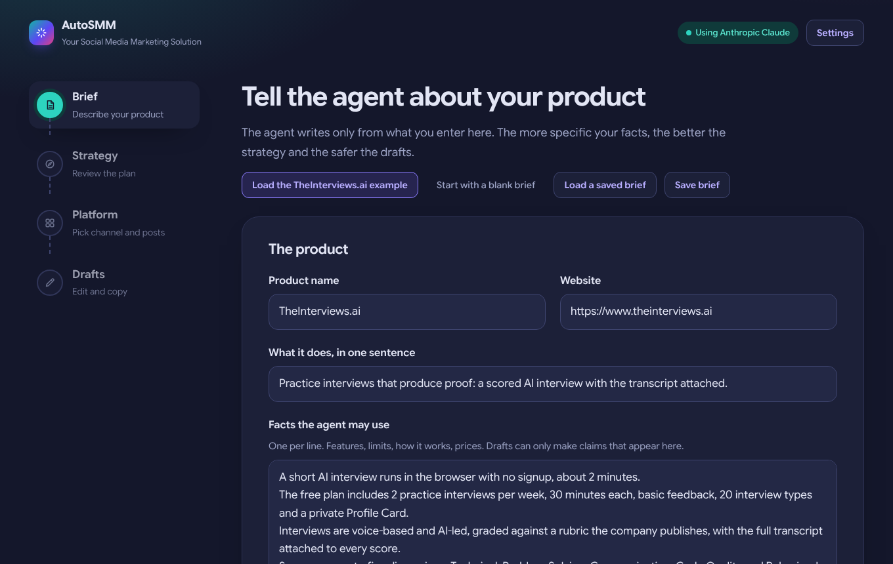
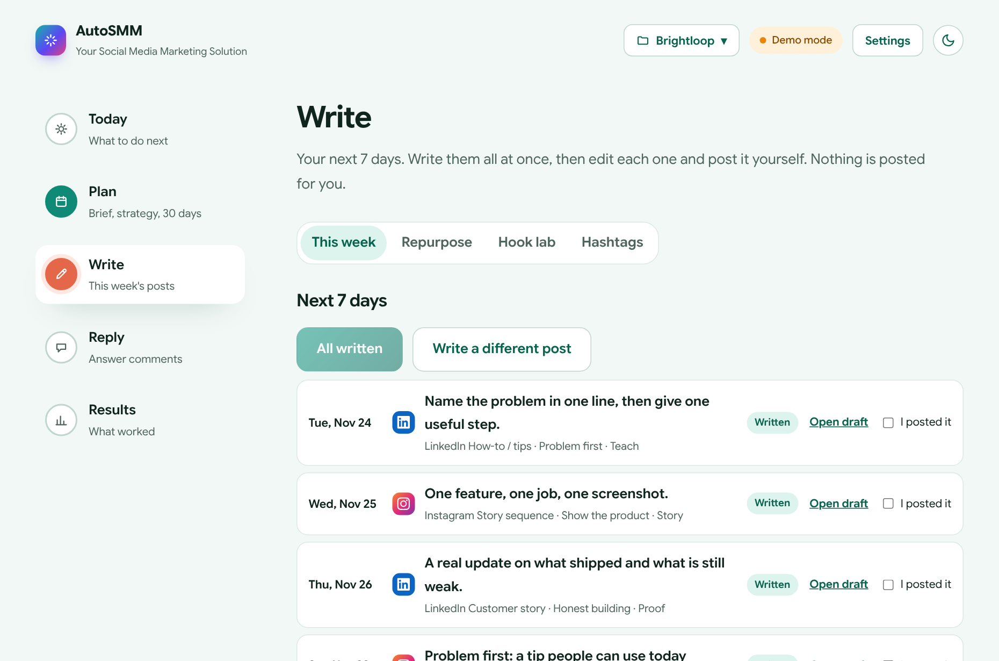

<div align="center">



# AutoSMM

**Your Social Media Marketing Solution**

Describe your product once. Get a social media strategy, then ready-to-edit posts for LinkedIn, Instagram, X, Facebook, YouTube, TikTok and Reddit.

[](LICENSE)


<br>

</div>

> [!IMPORTANT]
> **It never posts for you.** No auto-posting, no automated connection requests, no automated replies. You edit the draft, copy it, and publish it yourself.

## Why AutoSMM

You might be a great developer with a great idea and a great product. But if you cannot market it, reach the right audience or attract users, the product may not succeed. That is why AutoSMM exists. It helps you build a strategy and a base for your marketing plan, at least until you can afford to hire a professional marketing manager or director.

## Download the app (Windows and Mac)

No Node.js, no terminal and no setup. AutoSMM is a normal desktop app, and everything stays on your own computer, saved work included.

<p align="center">
  <a href="https://github.com/heyshantanugupta/autosmm/releases/download/v1.2.0/AutoSMM-Setup-1.2.0-windows-x64.exe"></a>
  &nbsp;
  <a href="https://github.com/heyshantanugupta/autosmm/releases/download/v1.2.0/AutoSMM-1.2.0-mac-arm64.dmg"></a>
  &nbsp;
  <a href="https://github.com/heyshantanugupta/autosmm/releases/download/v1.2.0/AutoSMM-1.2.0-mac-x64.dmg"></a>
</p>

Click a button, open the file you downloaded, and follow the prompts. Other options:

- **Windows without installing:** [AutoSMM-Portable-1.2.0-windows-x64.exe](https://github.com/heyshantanugupta/autosmm/releases/download/v1.2.0/AutoSMM-Portable-1.2.0-windows-x64.exe) runs straight from wherever you save it.
- **Not sure which Mac you have?** Open the Apple menu and choose About This Mac. If it says "Chip: Apple M1" (or M2, M3 and so on), use Apple chip. If it says "Intel", use Intel.
- **All versions:** see the [Releases page](https://github.com/heyshantanugupta/autosmm/releases).

> [!WARNING]
> The apps are not code signed yet (that costs the developer a yearly fee), so the first launch shows a warning. AutoSMM is open source, so you can read every line of it here. The warning is expected and appears once per install.
>
> **Windows:** choose "More info", then "Run anyway".
>
> **Mac:** if you see "AutoSMM Not Opened", pick one of these:
>
> 1. **Easiest:** drag AutoSMM to Applications and open it. Click **Done** on the warning, then open **System Settings > Privacy & Security**, scroll down to the message about AutoSMM and click **Open Anyway**. Enter your password and open the app again.
> 2. **One command:** drag AutoSMM to Applications, open **Terminal**, paste this and press Enter, then open the app normally:
>
>    ```bash
>    xattr -cr /Applications/AutoSMM.app
>    ```
>
> Do not click "Move to Trash". If you did, download the app again.

## What it looks like

A quick look, using a made-up habit tracker called Brightloop in demo mode.





You also get strategy, a 30-day plan, a reply helper, a results review and projects, in light and dark mode.

## What's new

**v1.2.1**
- **Start from your website** works on more sites, and **Build strategy** now tells you what is missing.

**v1.2.0**
- **Projects:** a separate brief, plan and drafts for each product, with a menu to switch, rename, duplicate and delete.
- **Export and import** a project as a file, for backups or another computer.
- **New teal and green colors**, with a neutral dark grey dark mode.

**v1.1.0**
- **Today view** with one next step, and tabs for Plan, Write, Reply and Results.
- **30-day plan** and **write the week** in one click. CSV download included.
- **Reply helper** for comments and messages, plus calm replies to negative reviews.
- **Results log and weekly review** so you know what to do more of.
- **Your voice**, **Repurpose**, **Hook lab**, **Hashtags and keywords**, and an **approval checklist** on every draft.
- **Start from your website** and a **light and dark mode button**.

See [every version](CHANGELOG.md).

> [!TIP]
> The desktop app has a few extras: local models through Ollama work, "Download PDF" saves a real PDF file, and links such as "Post on LinkedIn" open in your normal browser.

## Choose how it writes

Open Settings inside the app and pick a provider. They are grouped by how you usually pay:

- **Has a free tier:** Google Gemini, Groq or OpenRouter. Create a key, paste it in Settings, done. Free tiers have rate limits, and a paid key from the same provider works too and gives you higher limits. (Groq with a q is a different company from xAI's Grok.)
- **Runs on your computer:** Ollama, with models stored on your own machine (works in the desktop app and when you run from source).
- **Paid API key:** Anthropic Claude (best quality), OpenAI ChatGPT or xAI Grok. Each needs its own API key, which is billed separately from any chat subscription.
- **No key at all:** turn on Demo mode in Settings. It builds the whole flow from templates, not a model, so you can look around first.

> [!NOTE]
> Free-tier terms and model names change, and providers retire models. If you see "model not available", open Settings, paste your key and click **Check available models** to list what your key can use, then pick one.

## What it does

1. **Brief:** product, facts, audience, goal, channels, real proof, things never to say, tone. Save it as a file and load it any time.
2. **Strategy:** positioning, audiences, content themes, platform roles, weekly rhythm, how to measure, risks, and gaps in your brief. Download it as PDF or Word.
3. **Platform and post types:** each platform has post types that fit its norms. Set a tone, extra rules and a feature to focus on for each batch.
4. **Drafts:** editable text with a character counter, a fact check that re-runs as you type, a tracked link with setup help, and "Post on" buttons that copy the post and open the platform.
5. **Images:** say yes to an image and get a ready-to-paste prompt, plus buttons that open Gemini or ChatGPT.

## Bring your own key

> [!NOTE]
> You never pay for other people's usage: each user brings their own key for the provider they choose.

- Your key is kept in the browser tab (sessionStorage). It is saved to localStorage only if you tick "remember".
- It is sent to this app's own API routes in a request header and passed straight to the chosen provider for that one call.
- The server does not store or log it. Deploy this yourself if you want to be sure of that.
- Settings has a button that clears the key, brief and drafts.

## Keeping drafts honest

The agent is told to write only from the facts you give it. After generation, and again live as you edit, the app checks each draft:

- Every claim the draft says it relies on must match your facts or proof.
- Numbers in the text must appear in your inputs.
- Phrases from your "never say" list are flagged.
- If your style rules say "no em dash", em dashes are flagged.

Flags appear in the margin next to the draft. They are warnings, not blocks: you decide.

## Per-batch options, tracked links and posting

- **Per-batch settings.** In the Platform step you can set a tone, extra rules and a feature to focus on for just that batch. They sit on top of the brief, so you never have to edit the brief between posts. Each draft remembers its batch, so rewrites and the live checks use the same settings.
- **Tracked links.** Every draft shows a slug (for example `li-founder-story`). The draft sheet explains how to turn it into a tracked link (`utm_source`, `utm_medium=social`, `utm_campaign`), where to place the link on that platform, and where to see the clicks in Google Analytics (Traffic acquisition, Session campaign).
- **Post on a platform.** Each draft has a "Post on <Platform>" button. It copies the post, then opens that platform's compose page in a new tab. X is filled in for you (up to 280 characters). The other platforms open their post page and you paste with Ctrl+V. The app never posts anything for you.
- **Image prompts.** Each draft asks whether you want an image. Choosing Yes shows a ready-to-paste prompt built from that draft's visual idea, your product and your audience, plus buttons that copy it and open Gemini or ChatGPT (ChatGPT also gets the prompt filled in).

- **Save and load a brief.** On the first step, Save brief downloads your brief as a small file and Load a saved brief puts it back, on any device. The file holds only the brief, never an API key or drafts.
- **Download the strategy.** The strategy page can export the report as a PDF (choose Save as PDF in the print window) or as a Word (.docx) file.
- **OpenAI.** Choose OpenAI ChatGPT in Settings and paste an OpenAI API key. A ChatGPT subscription is billed separately and does not include API access.

## How it works

Next.js (App Router) and TypeScript. Anthropic uses forced tool use, so the model returns JSON that matches a schema. Other providers use the OpenAI-compatible chat API in JSON mode with the schema in the prompt. Either way the server validates and cleans the result.

The server only connects to the fixed provider endpoints in `lib/llm.ts`, never to a URL the browser supplies. Ollama is blocked on production deployments unless `ALLOW_LOCAL_MODELS=1` is set.

```
app/api/strategy   POST: brief in, strategy out
app/api/drafts     POST: brief, strategy, platform, post types in, drafts out
lib/providers.ts   supported providers, models and key hints
lib/llm.ts         Anthropic and OpenAI-compatible calls
lib/prompts.ts     system prompts and output schemas
lib/claims.ts      claim, number and phrase checks (unit tested)
lib/postTypes.ts   platform norms, limits and post types
lib/demo.ts        template output for demo mode
components/        the four steps, settings panel and platform marks
```

## Limits

- Output quality depends on the facts you enter. Thin input gives generic drafts, and the strategy step lists what is missing.
- Claim checks are text matching, not fact checking. Read every draft before posting.
- Smaller free models follow instructions less reliably, so expect more rewrites and more flags from the claim checks. Model names are in `lib/providers.ts`.

## For developers

> [!NOTE]
> Most people should use the downloads above. This section is only for running the project from source.

To run from source you need [Node.js](https://nodejs.org) 20 or newer.

```bash
npm install
npm run dev
```

Open http://localhost:3000.

Other commands: `npm test`, `npm run typecheck`, `npm run build`, `npm start`.

**For you (the maintainer):**

- `npm run desktop` builds the app and opens it in a desktop window for testing.
- `npm run dist:win` and `npm run dist:mac` build installers into `release/`. Windows installers build on Windows and Mac installers build on a Mac, so use the workflow below instead of building both yourself.
- The `Build desktop apps` workflow (in `.github/workflows`) builds both on GitHub. Push a tag such as `v1.0.0` and the installers are attached to a new Release automatically.
- To remove the warnings you need to sign the apps: an Apple Developer account (99 USD per year) for Mac, and a code signing certificate for Windows.

## License

MIT, copyright 2026 Shantanu Gupta. See the LICENSE file.
